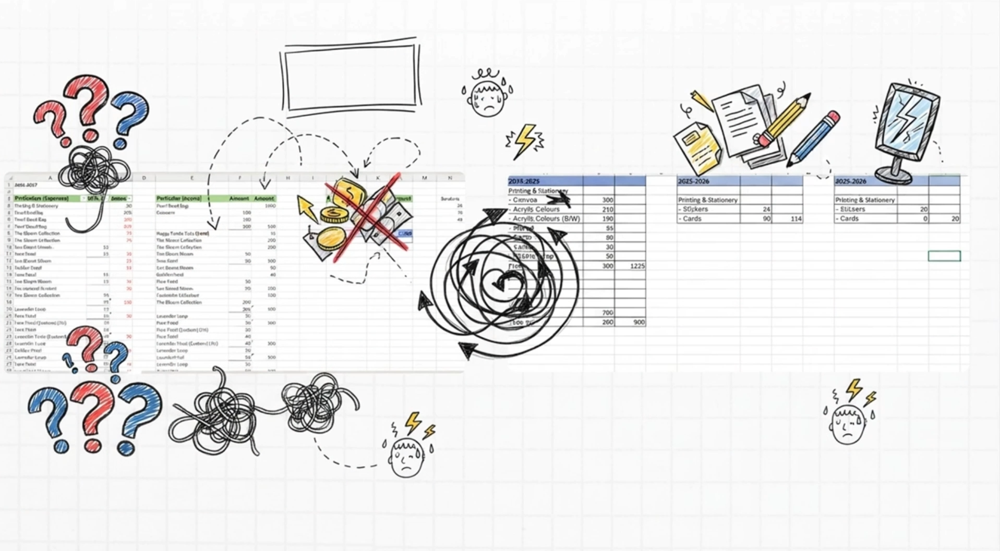
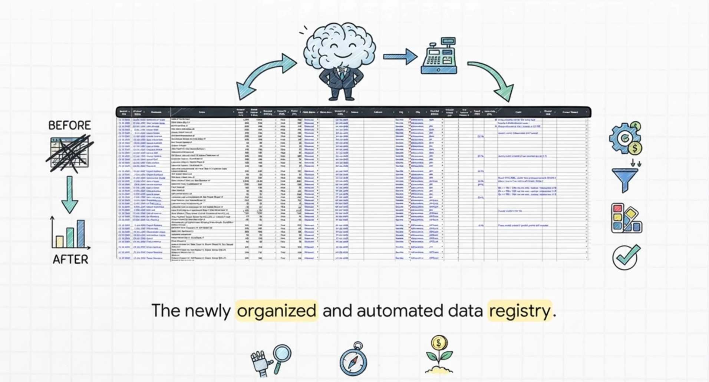
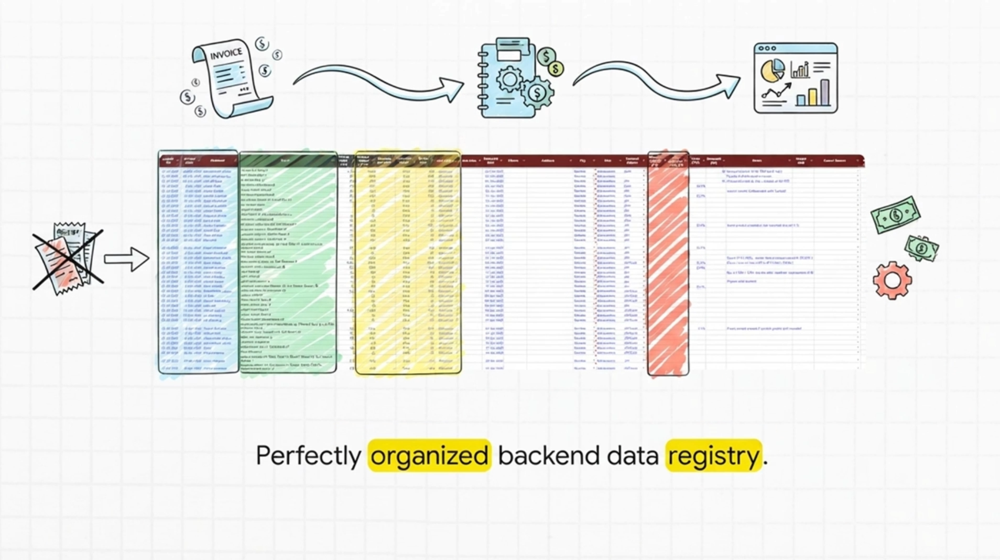
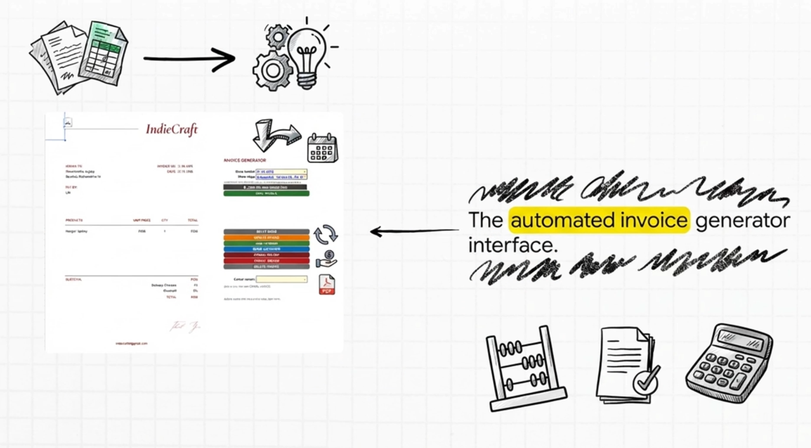
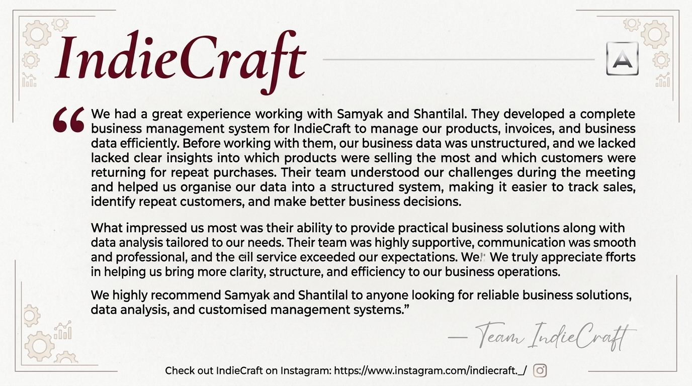
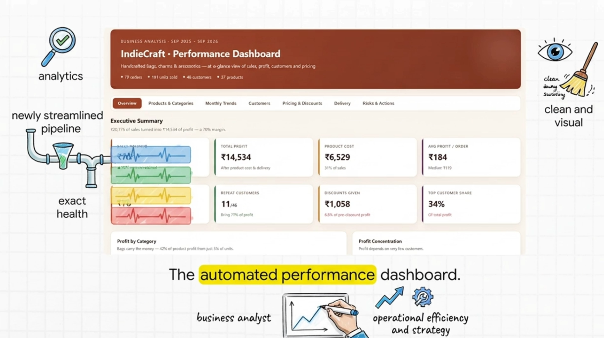
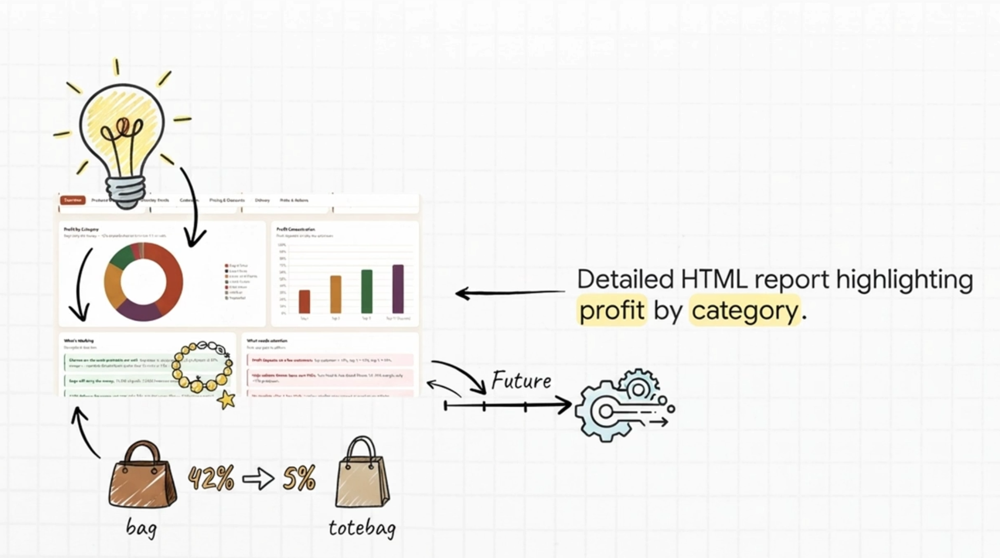

# 📊 IndieCraft Business Management & Analytics Ecosystem

An end-to-end business automation and analytical suite built for my first freelance client project, **[IndieCraft](https://www.instagram.com/indiecraft._/)**. This project transforms raw client inputs—a single unstructured transaction sheet and historical PDF invoice records—into a robust cloud spreadsheet ecosystem backed by custom VBA/Apps Script automation and strategic business intelligence.

---

### 🔄 Project Lifecycle & Evolution

#### 1. The Challenge: Messy Data & Fragmented Records
When the client reached out, operational records were logged randomly in an unstructured format, creating severe bottlenecks in order tracking, payment verification, and invoice generation.

#### 2. Data Extraction, Structuring & Verification
We extracted and parsed historical invoice records from PDF samples, cross-verifying entries directly with the client to establish a clean, reliable, structured baseline dataset.

| Structured Data Setup | Verified Transaction Register |
| :---: | :---: |
|  |  |

#### 3. Excel VBA Automation & Invoicing Engine
We originally engineered an automated Business Manager in Microsoft Excel using advanced VBA macros and custom formulas to auto-compile invoices matching legacy designs, track advance payments held, and sync entries directly to a master Invoice Register.

| Automated PDF Invoice Generator | System Feedback & Order Alerts |
| :---: | :---: |
|  |  |

#### 4. Executive Dashboard & Google Sheets Migration
To bypass Microsoft Excel licensing constraints while retaining full automation, we migrated the entire system to **Google Sheets**, translating VBA logic into **Google Apps Script**. We also built dynamic dashboards (both in-sheet and web-based) to give the client an at-a-glance operational overview.

---

### 🌟 Key Features & Technical Architecture

1. **Data Extraction, Structuring & Verification**
   - Extracted, parsed, and organized historical records and unstructured transaction logs from PDF invoice samples.
   - Collaborated directly with the client to cross-verify data integrity and establish a reliable baseline dataset.

2. **VBA Business Manager & License Migration**
   - **Phase 1 (Excel VBA)**: Engineered a complete, automated business manager in Microsoft Excel utilizing advanced **VBA macros and custom formulas** to process verified transactions, track pending orders, and compute operational metrics.
   - **Phase 2 (Google Sheets Migration)**: Rebuilt and adapted the underlying logic using **Google Apps Script** in Google Sheets, resolving software licensing constraints while enabling cloud multi-user access.

3. **Automated PDF Invoice Generator & Register Sync**
   - Replicated legacy invoice layouts from historical sample PDFs into an automated generation template.
   - Auto-syncs newly compiled invoices to a master **Invoice Register**, keeping real-time track of pending orders, advance payments held, and unfulfilled balances.

4. **At-a-Glance Executive Dashboard**
   - Designed a centralized operational dashboard summarizing key fulfillment pipelines, payment statuses, and revenue streams without manual spreadsheet filtering.

5. **Strategic Business Intelligence & Unit Economics Report**
   - Conducted deep-dive statistical and unit economics analysis:
     - **Product Profitability**: Highlighted high-margin product categories (e.g., Keychains & Charms at an **84% profit margin**) against lower-margin volume lines[cite: 1].
     - **Customer Retention & Concentration**: Mapped buyer behavior indicating repeat customers generate **71% of total profit**[cite: 4].
     - **Discount & Logistics Review**: Evaluated discount distribution and courier cost coverage to defend gross profit margins[cite: 1, 5].
   - Formulated a structured **Product & Stock Management Roadmap** for future inventory control[cite: 6, 7].

6. **Interactive Visual Web Dashboard**
   - Developed a standalone HTML5/CSS3/JavaScript web dashboard to present key analytical findings through interactive data cards and charts.

---

### 💡 Key Learnings: Client Collaboration & Project Management
Delivering my first freelance project provided invaluable lessons in professional engineering:
- **Active Communication & Data Validation**: Learned how to bridge messy real-world data gaps by communicating closely with the client to verify ambiguous records.
- **User-Centric Design**: Focused on building intuitive solutions that match the client's existing workflows rather than over-complicating architecture.
- **Problem-First Development**: Prioritized solving acute business pain points (pending orders, uncollected advances, manual invoice fatigue) above all else.

---

### 🛠️ Tech Stack & Tools Used
- **Automation / Backend**: VBA (Excel Macros), Google Apps Script, JavaScript
- **Spreadsheet Infrastructure**: Google Sheets, MS Excel
- **Frontend Reporting**: HTML5, CSS3, JavaScript (Interactive Visual Dashboard)
- **Data Analysis & Modeling**: Unit Economics & Customer Segmentation Frameworks
